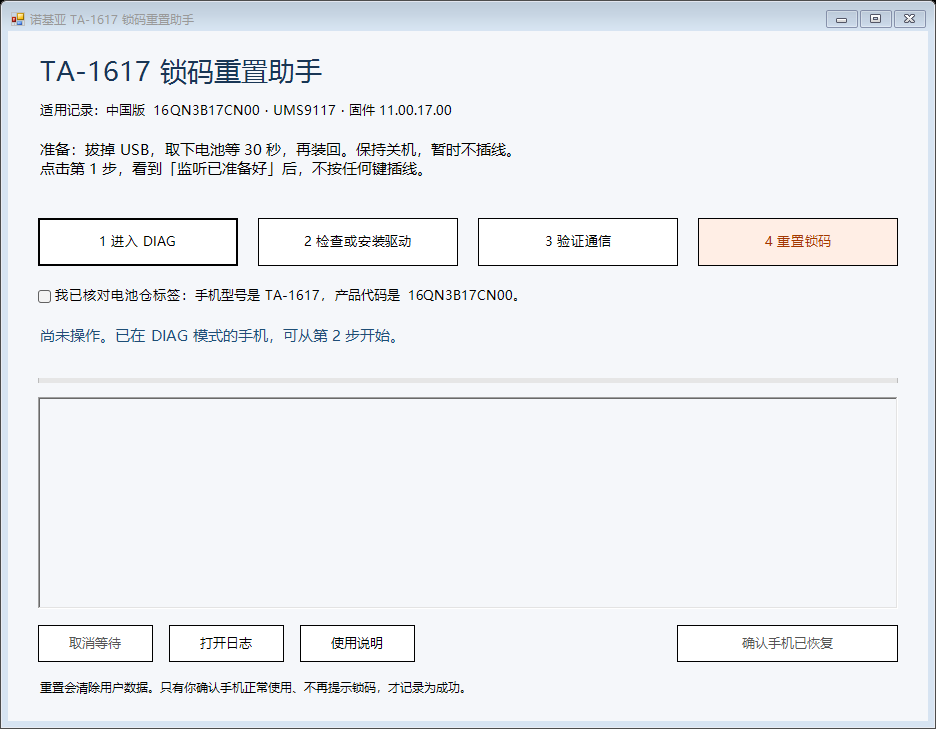

# Nokia TA-1617 中文锁码重置助手

通过 Windows 电脑和 USB 数据线，以中文界面逐步进入 DIAG、检查驱动、核验固件并恢复出厂，解除忘记的手机锁码。无需 Python，不用输入协议命令。

**恢复出厂会清除手机用户数据。仅用于本人拥有或获授权维护的手机。**

## 已验证范围

| 项目 | 本次成功设备 |
| --- | --- |
| 手机 | Nokia 220 4G 2024，中国版 |
| 电池仓型号 | TA-1617 |
| 产品代码 | 16QN3B17CN00 |
| 硬件 | UMS9117 |
| 软件 | 11.00.17.00 |
| 平台 | MOCOR_20A_MP_W22.04.6_P5_Release |

上述设备通过原始脚本接受 DIAG 恢复出厂命令，随后机主确认恢复使用。原始成功入口使用 WinUSB。中文 GUI 的协议解析、命令构造及按钮保护已通过 17 项离线检查；**整套 GUI 流程和新增展讯串口入口尚未重新实机验证**。这不是所有 Nokia 手机的通用解锁器。

软件每次发送重置命令前重新读取硬件、平台及固件版本，不匹配就停止。TA 型号和产品代码需人工核对机身标签；软件不读取 IMEI，不自动验证标签型号。软件不枚举密码、不刷固件、不修改 NV 或 IMEI。

## 下载与启动

1. 打开 [Releases](https://github.com/ckbrothers/nokia-ta1617-reset-assistant/releases)，下载 `TA-1617-reset-assistant-v1.0.0-beta.1.zip`。
2. 解压全部文件到可写目录，双击 **启动工具.cmd**。需要 Windows 10/11 64 位和系统自带 Windows PowerShell 5.1。
3. 首次运行需要联网，自动从原来源下载 USB 库、解压工具和驱动，核对固定 SHA-256，并验证驱动签名。此时只准备文件；安装驱动仍由你在界面点击，Windows 会要求管理员权限。
4. 若组件源暂不可访问，保留错误信息后重试。不要从不明网站换用同名文件。以后组件保存在本地，无需重复下载。

也可通过绿色 **Code → Download ZIP** 下载源码。不要单独保存一个 `.ps1`，它依赖同目录文件。此包未附带 EXE 安装器。



## 按步骤操作

1. 手机拔掉 USB，取下电池等 30 秒，装回电池并保持关机，先不要插线。
2. 点击 **1 进入 DIAG**。看到监听准备好后，**不按任何键**，直接插线，等待出现 `VID_1782&PID_4D03`。
3. 点击 **2 检查或安装驱动**，根据 Windows 提示允许安装。应出现 DIAG 串口（`MI_00`）和 LOG 串口（`MI_01`），COM 编号因电脑而异。
4. 点击 **3 验证通信**，必须读取匹配固件和有效 DIAG `OK` 回应。
5. 核对电池仓标签为 `TA-1617 / 16QN3B17CN00`，勾选确认，点击 **4 重置锁码**，确认清除用户数据。
6. 等待手机重启。命令被接受只证明设备接受请求；检查手机能否开机并正常使用，随后点击 **确认手机已恢复**，才会保存成功记录。

如果已经有 DIAG 串口，可从第 3 步开始。连接和验证不会自动发送重置命令。每次重置都需要显式确认；结果不明确时不自动重试清除。

### 连接问题

- 只有充电图标：检查是否真正使用数据线、USB 插口、完全断电以及先监听后插线的顺序。
- `4D00` 没有驱动：先点击第 2 步安装 UNISOC 串口驱动，再彻底断电重试。该串口入口尚待实机验证。
- 已有 WinUSB：程序兼容已验证的 WinUSB 入口。如果确需配置 WinUSB，可使用 [Zadig 官方工具](https://zadig.akeo.ie/)，只选择 `VID_1782&PID_4D00`。不要将 `4D03` 的 DIAG/LOG 串口改成 WinUSB。
- 按住星号键进入的是启动下载模式；`SPRD3` 或下载 ACK 不是有效 DIAG 通信。
- “取消等待”可取消连接和只读查询，不能撤回已经发送的恢复出厂命令。

运行记录保存在 `运行日志`。分享排错信息前自行检查日志内容；请勿上传 IMEI、手机 NV、用户数据或账号凭据。

## 成功方法与协议

见 [docs/成功记录.md](docs/成功记录.md)。此仓库只包含通用版本/OK 测试回应，不包含个人设备标识、NV 备份、FDL、固件或个人日志。没有找到并依赖锁码字段映射；成功方法是 DIAG 中的恢复出厂命令。

## 离线验证

```powershell
powershell.exe -NoProfile -ExecutionPolicy Bypass -File .\tests\offline-tests.ps1
powershell.exe -NoProfile -STA -ExecutionPolicy Bypass -File .\gui.ps1 -UiCheck
```

这两项不会向手机发送指令，分别检查 12 个协议/重置保护条件和 5 个界面状态条件。GitHub Actions 在 Windows 上执行相同检查。

## 授权与组件来源

本工具源码按 **GPL-3.0** 发布，见 [LICENSE.txt](LICENSE.txt)。模式切换和重置命令参考 [spreadtrum_unisoc_at](https://github.com/wutaijieing/spreadtrum_unisoc_at)。本项目与 Nokia、HMD、UNISOC 无隶属关系。

第三方组件在首次启动时从原来源下载，不包含在源码包中，各自保留原授权：

- USB DLL：来自 [spreadtrum_flash 1.20260403](https://github.com/ilyakurdyukov/spreadtrum_flash/releases/tag/1.20260403)，[libusb 源码与 LGPL 授权](https://github.com/libusb/libusb)。
- UNISOC 驱动 4.21.39.134：来自 [Infinity 支持目录](https://dl1.infinity-box.com/00/pub/?dir=/soc-drivers/SPD-Unisoc/)，核验 Microsoft / UNISOC 签名。
- 7zr 26.04：来自 [7-Zip 官方项目](https://github.com/ip7z/7zip/releases/tag/26.04)。

固定下载 URL 和 SHA-256 见 [setup.ps1](setup.ps1)。系统执行策略只通过启动进程参数指定，不永久更改。

## English

Windows PowerShell GUI with Chinese instructions for owner-authorized factory reset of Nokia TA-1617 (China, product 16QN3B17CN00), firmware 11.00.17.00 / UMS9117. Factory reset erases user data. The underlying DIAG reset succeeded on one device; the complete GUI and serial entry route have only been checked offline. It verifies firmware before reset and requires manual model confirmation and explicit erase consent. Download the release ZIP, extract it, and run `启动工具.cmd`. Third-party dependencies are fetched from their original sources and checked by pinned hashes/signatures. GPL-3.0 source.
